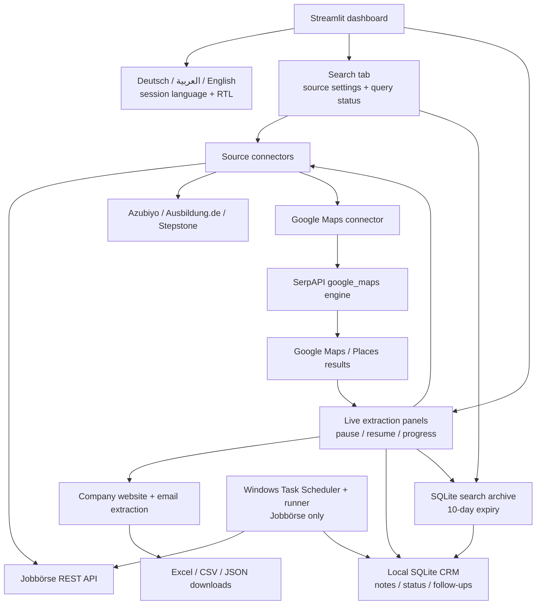
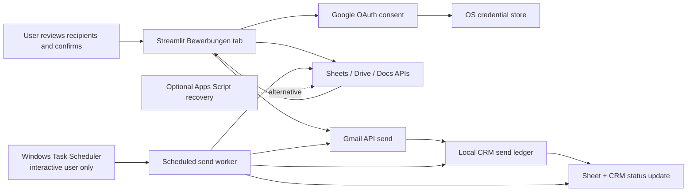
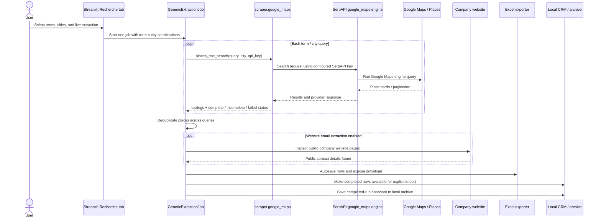

# App architecture and Google Maps workflow

## Application overview

`streamlit_app.py` is the dashboard entry point. Search and live extraction
are distinct actions: a standard search saves provider listings to the local
archive, while a live extraction can inspect company websites for contact
details and create an Excel workbook. Dashboard CRM import is explicit; the
opt-in scheduled Jobbörse runner also imports results to CRM automatically
under its configured purpose and legal basis. The legacy CLI entry point is
`app.py`; it uses `scraper/engine.py` and shares connectors but does not use
the dashboard UI.

Local persistence is split by purpose:

| File | Contents |
|---|---|
| `output/arbeitsagentur.sqlite` | Jobbörse searches, listings, and run status |
| `output/search_history.sqlite` | Dashboard search and completed live-job snapshots; 10-day expiry |
| `output/crm.sqlite` | CRM records, workflow/history, privacy actions, and salted-recipient send ledger with confirmed Gmail message IDs |
| `output/scheduled_search.sqlite` | Run history for the optional scheduled Jobbörse search |
| `output/google_send_runs.sqlite` | Local run history for scheduled Google application sends |
| `output/job_states/` | Resumable live-extraction job checkpoints |
| `output/*.xlsx` | Autosaved live-extraction workbooks |

Google refresh tokens are stored in the operating system's credential store
(Windows Credential Manager on Windows), not in these output files or the
repository. Disconnecting the Google account removes the stored credential.

## Google applications: setup, send, and recovery

After OAuth consent, the dashboard discovers or creates the application
spreadsheet and Docs template, finds a Drive PDF, and syncs eligible CRM leads.
Sending remains an explicit, recipient-reviewed action. A daily Windows task
can be enabled separately; it runs under the signed-in Windows user, refreshes
the selected CRM-to-Sheets data, obeys the configured cap and delay, and checks
its enabled state between messages. The schedule stores a snapshot of the
explicitly selected CRM lead IDs and email addresses; it never broadens to all
CRM leads. Changed, deleted, or opted-out recipients are skipped and reported
for review.

The sender reserves a recipient in SQLite before sending. Gmail's returned
message ID is persisted to the local ledger before trying to update the Sheet
and CRM. Transient errors receive bounded backoff retries. A confirmed Gmail
send is never retried because a later Sheet/CRM update failed. If the result
from Gmail is ambiguous, the recipient is marked `VERIFY_REQUIRED`; errors and
pending Sheet synchronization appear in the local run history. Daily limits
are safety controls, not additional Gmail quota. Google API activity remains
unavailable until OAuth credentials, consent, and APIs are configured.

The generated Apps Script remains a collapsed, opt-in recovery path. It has
separate trigger/property state and does not share the direct app's local CRM
ledger.

## Google Maps: request to saved lead

### Google Maps setup and limits

- Google Maps search **requires a SerpAPI API key**. Configure `SERPAPI_KEY`
  in `.streamlit/secrets.toml` or the environment; the dashboard also accepts a
  key in the Google Maps settings panel for the current session. The connector
  sends this key to SerpAPI's `google_maps` engine. It is not a Google Maps
  browser session or a direct Playwright scrape.
- Google Maps/Places and SerpAPI responses are subject to account quotas,
  costs, pagination, and provider-side limits. Results are not unlimited; the
  dashboard reports completeness for each term/city query.
- The app uses one configured key. It does **not** rotate API keys or accounts,
  evade quotas, or bypass provider controls. Playwright scraping of Google
  Maps is not used by this connector.
- When live website extraction is enabled, the app checks company websites
  after finding places. It does not guarantee that each company publishes an
  email address. A Maps search without live extraction only returns the fields
  supplied by the connector; it does not perform contact enrichment.
- The daily Windows task is deliberately limited to the public Jobbörse API.
  Google Maps searches are user-started; no scheduled Maps scraping or
  background quota workaround is installed.

## Language and direction

The top language selector stores `Deutsch`, `العربية`, or `English` in
Streamlit session state. UI labels and dashboard controls use the shared
translation catalogue in `scraper/i18n.py`; Arabic applies right-to-left
layout rules. Search terms, provider names, source data, logs, and exported
record contents are not machine-translated.
